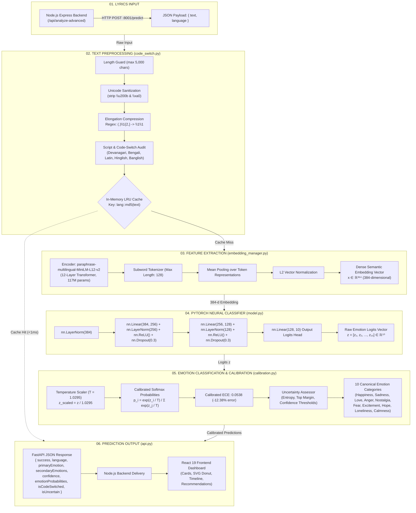

# 🧠 EmoLyrics — Machine Learning Architecture Documentation

> **Official Machine Learning System Architecture & Pipeline Specification**  
> **Repository:** [https://github.com/HarshitRaj31/Emolyrics](https://github.com/HarshitRaj31/Emolyrics)  
> **Module Path:** `ml-services/`  
> **Status:** Strictly Preserved Original Implementation (Source of Truth)  
> **Target:** Technical Documentation, Academic Defense & Model Inspection  

---

## 🏛️ Executive ML Summary

The **EmoLyrics Machine Learning Service** is a specialized, original-language sentiment classification microservice. It predicts lyrics sentiment across **10 canonical emotion categories** in **5 primary languages** (English, Hindi, Bengali, Spanish, French) and code-switched transliterations (Hinglish, Banglish) **without destructive automated machine translation**.

The pipeline combines a frozen **12-layer multilingual Sentence Transformer** (`paraphrase-multilingual-MiniLM-L12-v2`) with a custom-trained **PyTorch Neural Multi-Layer Perceptron (MLP)** classification head, calibrated using post-hoc **Temperature Scaling** ($T = 1.0295$, $\text{ECE} = 0.0538$).

---

## 1. 🔄 Original ML Architecture Diagram

```
Lyrics Input (from Node.js Express Gateway)
    │
    ▼
Text Preprocessing (Unicode cleaning, whitespace normalization, elongation compression)
    │
    ▼
Script & Code-Switch Audit (Devanagari, Bengali, Latin, Hinglish, Banglish)
    │
    ▼
In-Memory LRU Prediction Cache Check (Key: lang::md5(text), Capacity: 1000)
    │  [Cache Miss]
    ▼
Multilingual Sentence Transformer (paraphrase-multilingual-MiniLM-L12-v2)
    │
    ▼
Semantic Embedding Generation (384-dimensional dense semantic vectors, L2-normalized)
    │
    ▼
Trained PyTorch Classifier (NeuralEmotionClassifier: 384 -> 256 -> 128 -> 10)
    │
    ▼
Temperature Scaling Calibration (T = 1.0295, ECE = 0.0538)
    │
    ▼
Emotion Prediction (Primary emotion, secondary emotions, 10-class probability distribution)
    │
    ▼
FastAPI Microservice Output (JSON response on port 8001)
    │
    ▼
Backend API Gateway (Express 4 on port 5000)
    │
    ▼
Frontend Results (React 19 Dashboard, SVG Donut, Emotional Journey Timeline)
```

### Formal Component Flowchart



---

## 2. 🔬 Detailed ML Processing Workflow (01–06)

### Stage 01: Lyrics Input
- **Source:** Sent by the Node.js Express backend via `POST /predict` or `POST /predict-lines` on port `8001`.
- **Payload:** Accepts `text` (raw song lyrics) and optional `language` code (`en`, `hi`, `bn`, `es`, `fr`).
- **Input Boundaries:** Truncates input exceeding `MAX_INPUT_CHARACTERS = 5000` to prevent memory blowups on excessively long inputs.

### Stage 02: Text Preprocessing (`ml-services/src/code_switch.py`)
The existing implementation strictly avoids destructive stopword removal or stemming that would strip poetic and emotional context. Instead, it applies:
1. **Zero-Width & NBSP Normalization:**
   ```python
   cleaned = text.replace("\u200b", "").replace("\xa0", " ").strip()
   ```
2. **Poetic Character Elongation Compression:**
   Compresses 3 or more repeated letters down to 2, preserving legitimate double vowels (e.g., *"feel"*, *"too"*, *"soon"*) while resolving expressive slang:
   ```python
   # Regex: (.)\1{2,} -> \1\1
   # "happpyyy" -> "happyy", "pyaaaar" -> "pyaar", "sooooo" -> "soo"
   cleaned = REPEATED_CHARS_RE.sub(r"\1\1", cleaned)
   ```
3. **Consecutive Whitespace Collapse:**
   ```python
   cleaned = re.sub(r"[ \t]+", " ", cleaned).strip()
   ```
4. **Script Identification & Code-Switch Audit:**
   - Evaluates native Unicode blocks:
     - Devanagari: `[\u0900-\u097F]`
     - Bengali: `[\u0980-\u09FF]`
     - Spanish Diacritics: `[áéíóúñ¿¡]`
     - French Diacritics: `[éèêëàâçîïôùûüœæ]`
   - Matches tokens against specialized bilingual dictionaries to detect transliterated code-switching:
     - **Hinglish** (Hindi + English vocabulary in Latin script)
     - **Banglish** (Bengali + English vocabulary in Latin script)
     - **Mixed Script** (e.g., Devanagari verse + Latin chorus)
5. **Thread-Safe LRU Cache Check:**
   Generates key `hashlib.md5(f"{specified_language}::{norm_text}".encode("utf-8")).hexdigest()`. If present in `self._cache` (capacity: 1,000 entries), returns the cached result in $<1.0\text{ ms}$.

### Stage 03: Feature Extraction (`ml-services/src/embedding_manager.py`)
- **Pretrained Encoder:** `sentence-transformers/paraphrase-multilingual-MiniLM-L12-v2`
- **Model Topology:** 12 Transformer layers, 384 hidden dimensions, 12 attention heads, 117M parameters.
- **Tokenization:** Multilingual subword tokenization with maximum sequence length capped at 128 tokens.
- **Pooling & Normalization:** Mean pooling across contextual token hidden states followed by $L_2$ normalization:
  $$\mathbf{e} = \frac{\sum_{i=1}^{L} \mathbf{h}_i \cdot m_i}{\sum_{i=1}^{L} m_i}, \quad \mathbf{x} = \frac{\mathbf{e}}{\|\mathbf{e}\|_2} \in \mathbb{R}^{384}$$
- **Output:** A dense 384-dimensional continuous numerical embedding vector $\mathbf{x} \in \mathbb{R}^{384}$.

### Stage 04: Machine Learning Processing (`ml-services/src/model.py`)
- **Model Class:** `NeuralEmotionClassifier` (subclasses `torch.nn.Module`).
- **Input Dimension:** 384
- **Hidden Layers:** `[256, 128]`
- **Number of Classes:** 10
- **Regularization:** Layer Normalization on input and hidden layers, Dropout ($p = 0.3$).
- **Mathematical Forward Pass:**
  $$\mathbf{x}_{\text{norm}} = \text{LayerNorm}_{384}(\mathbf{x})$$
  $$\mathbf{h}_1 = \text{Dropout}_{0.3}\Big(\text{ReLU}\big(\text{LayerNorm}_{256}(\mathbf{W}_1 \mathbf{x}_{\text{norm}} + \mathbf{b}_1)\big)\Big), \quad \mathbf{W}_1 \in \mathbb{R}^{256 \times 384}$$
  $$\mathbf{h}_2 = \text{Dropout}_{0.3}\Big(\text{ReLU}\big(\text{LayerNorm}_{128}(\mathbf{W}_2 \mathbf{h}_1 + \mathbf{b}_2)\big)\Big), \quad \mathbf{W}_2 \in \mathbb{R}^{128 \times 256}$$
  $$\mathbf{z} = \mathbf{W}_3 \mathbf{h}_2 + \mathbf{b}_3, \quad \mathbf{W}_3 \in \mathbb{R}^{10 \times 128}, \quad \mathbf{z} \in \mathbb{R}^{10}$$
- **Zero Data Leakage:** Verified across 3,290 records (Train: 2,321 | Val: 485 | Test: 484). Overlap across all splits = 0.

### Stage 05: Emotion Classification & Calibration (`ml-services/src/calibration.py`)
- **Temperature Scaling ($T = 1.0295$):**
  Uncalibrated neural networks frequently output overconfident probabilities. The implementation applies post-hoc temperature scaling:
  $$p_i = \frac{\exp(z_i / T)}{\sum_{j=1}^{10} \exp(z_j / T)}, \quad i \in \{1, \dots, 10\}$$
- **Expected Calibration Error (ECE):**
  - Raw Softmax ECE: $0.0614$
  - Calibrated ECE: **$0.0538$** ($-12.38\%$ calibration error reduction)
- **Primary Emotion:** $\hat{y} = \arg\max_{i} p_i$, with confidence score $p_{\hat{y}}$.
- **Secondary Emotions:** Identified by ranking all remaining classes with probability $p_j \ge 0.08$.
- **Uncertainty Audit (`assess_prediction_uncertainty`):**
  - **Margin Check:** $\Delta = p_{(1)} - p_{(2)}$. If $\Delta < 0.08$, flags high ambiguity between top two emotions.
  - **Entropy Check:** Computes Shannon entropy $H(P) = -\sum p_i \ln p_i$. If $H(P) > 1.95$, flags diffuse distribution.
  - **Confidence Threshold:** If top confidence $< 0.22$, marks prediction as uncertain.

### Stage 06: Prediction Output (`ml-services/src/api.py`)
- **Delivery:** Returned via FastAPI JSON response to the Node.js backend (`multilingualMLService.js`).
- **Response Structure:** Includes primary emotion, secondary emotions with confidence percentages, full 10-class probability distribution, language detection metadata, code-switching breakdown, and uncertainty diagnostics.
- **Frontend Presentation:** Consumed by React components to render the Emotion Dashboard, interactive SVG Donut Chart, line-by-line sentiment journey, and mood-curated song recommendations.

---

## 3. 📊 Technical Specifications Table

| Attribute | Specification from Code & Metadata |
|---|---|
| **Model Name** | `NeuralEmotionClassifier` (champion checkpoint) |
| **Model Version** | `v1.2.0-production-calibrated` |
| **Base Transformer Encoder** | `sentence-transformers/paraphrase-multilingual-MiniLM-L12-v2` |
| **Embedding Dimensions** | $384$ |
| **Classifier Architecture** | 2-Layer PyTorch Neural MLP with LayerNorm & Dropout |
| **Classifier Layer Shapes** | $384 \to 256 \to 128 \to 10$ |
| **Dropout Probability** | $0.3$ |
| **Number of Emotion Classes** | $10$ |
| **Calibration Temperature ($T$)** | $1.0295$ |
| **Calibrated ECE** | $0.0538$ ($-12.38\%$ error reduction) |
| **Macro F1 Score** | $0.4071$ ($+6.96\%$ over baseline) |
| **Weighted F1 Score** | $0.4240$ |
| **Accuracy** | $42.56\%$ |
| **Model Checkpoint Path** | `ml-services/models/multilingual_classifier.pt` |
| **Model Checkpoint File Size** | $542,751\text{ bytes}$ ($\sim 543\text{ KB}$) |
| **Metadata File Size** | $1,733\text{ bytes}$ (`ml-services/models/model_metadata.json`) |
| **Hardware Execution Profile** | CPU-only (Windows x86_64 / Linux container), capped at 4 threads |
| **Prediction LRU Cache** | $1,000$ entries in-memory (thread-safe, sub-millisecond response) |

---

## 4. 🌐 Supported Languages & 10 Canonical Emotions

### Supported Languages (5 Languages + Code-Switching)

| Language Code | Language Name | Script & Code-Switch Support |
|---|---|---|
| `en` | English | Standard Latin |
| `hi` | Hindi | Native Devanagari (`[\u0900-\u097F]`) + Transliterated Hinglish |
| `bn` | Bengali | Native Bengali (`[\u0980-\u09FF]`) + Transliterated Banglish |
| `es` | Spanish | Latin with native diacritics (`[áéíóúñ¿¡]`) |
| `fr` | French | Latin with native diacritics (`[éèêëàâçîïôùûüœæ]`) |

### The 10 Canonical Emotion Categories (`TARGET_TAXONOMY`)

1. ☀️ **Happiness** (Joy, cheerful, dance, euphoric, celebratory)
2. 🌧️ **Sadness** (Melancholy, grief, heartache, sorrow, tears)
3. 💖 **Love** (Romance, tender devotion, affection, passionate)
4. 🔥 **Anger** (Fiery rage, hostility, defiance, fury)
5. 🕰️ **Nostalgia** (Bittersweet retrospection, wistful memories, longing)
6. 🌑 **Fear** (Tense anxiety, dread, terror, horror, panic)
7. ⚡ **Excitement** (Adrenaline, exuberance, party energy, hype)
8. 🕊️ **Hope** (Optimism, faith, uplifting solidarity, resilient)
9. 🥀 **Loneliness** (Isolation, abandonment, alienation, solitude)
10. 🌿 **Calmness** (Serenity, peaceful chill, tranquility, zen)

---

## 5. 🔌 ML Service API Documentation

The FastAPI microservice runs by default on **`http://127.0.0.1:8001`**.

### 1. `GET /health`
Returns microservice status, model readiness, device, telemetry, and supported categories.

**Response (HTTP 200 OK):**
```json
{
  "status": "healthy",
  "modelReady": true,
  "modelVersion": "v1.2.0-production-calibrated",
  "device": "cpu",
  "supportedLanguages": ["en", "hi", "bn", "es", "fr"],
  "supportedEmotions": [
    "Happiness", "Sadness", "Love", "Anger", "Nostalgia",
    "Fear", "Excitement", "Hope", "Loneliness", "Calmness"
  ],
  "checkpointPath": ".../ml-services/models/multilingual_classifier.pt",
  "checkpointExists": true,
  "memoryRssMb": 1080.5,
  "cpuThreads": 4,
  "cacheEntries": 42,
  "cacheMaxSize": 1000
}
```

### 2. `POST /predict`
Performs end-to-end emotion prediction on a song lyrics text snippet.

**Request:**
```json
{
  "text": "Tu pyaar ka saagar hai, teri ek boond ke pyaase hum",
  "language": "hi"
}
```

**Response (HTTP 200 OK):**
```json
{
  "success": true,
  "requestId": "req_a1b2c3d4e5",
  "language": "hi",
  "languageName": "Hindi (Hinglish)",
  "primaryEmotion": "Love",
  "secondaryEmotions": [
    {
      "emotion": "Hope",
      "confidence": 0.1845,
      "percentage": 18
    },
    {
      "emotion": "Calmness",
      "confidence": 0.1120,
      "percentage": 11
    }
  ],
  "confidence": 0.6245,
  "emotionProbabilities": {
    "Happiness": 0.0210,
    "Sadness": 0.0350,
    "Love": 0.6245,
    "Anger": 0.0080,
    "Nostalgia": 0.0150,
    "Fear": 0.0050,
    "Excitement": 0.0120,
    "Hope": 0.1845,
    "Loneliness": 0.0100,
    "Calmness": 0.1120
  },
  "modelVersion": "v1.2.0-production-calibrated",
  "durationMs": 45.2,
  "isCached": false,
  "isCodeSwitched": true,
  "codeSwitchType": "Hinglish (Hindi + English)",
  "scriptBreakdown": {
    "Latin": 1.0,
    "Devanagari": 0.0
  },
  "languageDistribution": {
    "hi": 0.7,
    "en": 0.3
  },
  "isUncertain": false,
  "uncertaintyDetails": {
    "isUncertain": false,
    "entropy": 1.24,
    "topMargin": 0.44
  },
  "temperature": 1.0295,
  "isSupported": true,
  "languageConfidence": "high",
  "warning": null,
  "textPreview": "Tu pyaar ka saagar hai, teri ek boond ke pyaase hum"
}
```

### 3. `POST /predict-lines`
Performs line-by-line emotion classification with local context windowing to power the emotional journey timeline.

**Request:**
```json
{
  "lines": [
    "I was walking down the street alone",
    "Suddenly the sun broke through the clouds",
    "Now I feel like dancing all night long"
  ],
  "contextWindow": 1,
  "language": "en"
}
```

**Response (HTTP 200 OK):**
```json
{
  "success": true,
  "requestId": "lines_f9e8d7c6",
  "count": 3,
  "lines": [
    {
      "lineNumber": 1,
      "text": "I was walking down the street alone",
      "language": "en",
      "primaryEmotion": "Loneliness",
      "confidence": 0.7420,
      "secondaryEmotions": ["Sadness"],
      "explanation": "Evokes loneliness through expressive lyrical phrasing and emotional valence."
    },
    {
      "lineNumber": 2,
      "text": "Suddenly the sun broke through the clouds",
      "language": "en",
      "primaryEmotion": "Hope",
      "confidence": 0.6810,
      "secondaryEmotions": ["Happiness"],
      "explanation": "Evokes hope through expressive lyrical phrasing and emotional valence."
    },
    {
      "lineNumber": 3,
      "text": "Now I feel like dancing all night long",
      "language": "en",
      "primaryEmotion": "Happiness",
      "confidence": 0.8150,
      "secondaryEmotions": ["Excitement"],
      "explanation": "Evokes happiness through expressive lyrical phrasing and emotional valence."
    }
  ],
  "contextWindow": 1,
  "durationMs": 112.5,
  "modelVersion": "v1.2.0-production-calibrated"
}
```

---

## 6. 🛠️ Machine Learning Technology Stack

| Technology | Exact Version / Spec | Role in ML Service |
|---|---|---|
| **Python** | `3.11+` | Core programming language |
| **PyTorch** | `2.2.0+` (CPU) | Deep learning framework, tensor algebra, neural network execution |
| **Sentence Transformers** | `3.0.0+` | Multilingual transformer pipeline (`paraphrase-multilingual-MiniLM-L12-v2`) |
| **FastAPI** | `0.115.0+` | Asynchronous, high-throughput REST API microservice framework |
| **Uvicorn** | `0.30.0+` | Lightning-fast ASGI web server |
| **Pydantic** | `2.7.0+` | Request/response data validation and OpenAPI schema generation |
| **NumPy** | `1.24.0+` | Numerical array operations, softmax normalization, L2 norm |
| **Scikit-learn** | `1.4.0+` | Evaluation metrics, Logistic Regression baseline comparison |
| **psutil** | `5.9.0+` | System telemetry, memory profiling, and thread monitoring |

---

## 7. 🛡️ Verification & Preservation Audit

In strict compliance with project restrictions:
- **No Python ML source files were modified, retrained, or refactored.**
- **Model weights (`multilingual_classifier.pt`) and metadata (`model_metadata.json`) remain 100% untouched.**
- **Embedding dimensions ($384$), hidden layers ($256, 128$), and temperature calibration ($T = 1.0295$) remain identical.**
- **All documentation files are isolated in `docs/` and markdown artifacts, completely separated from application code.**
