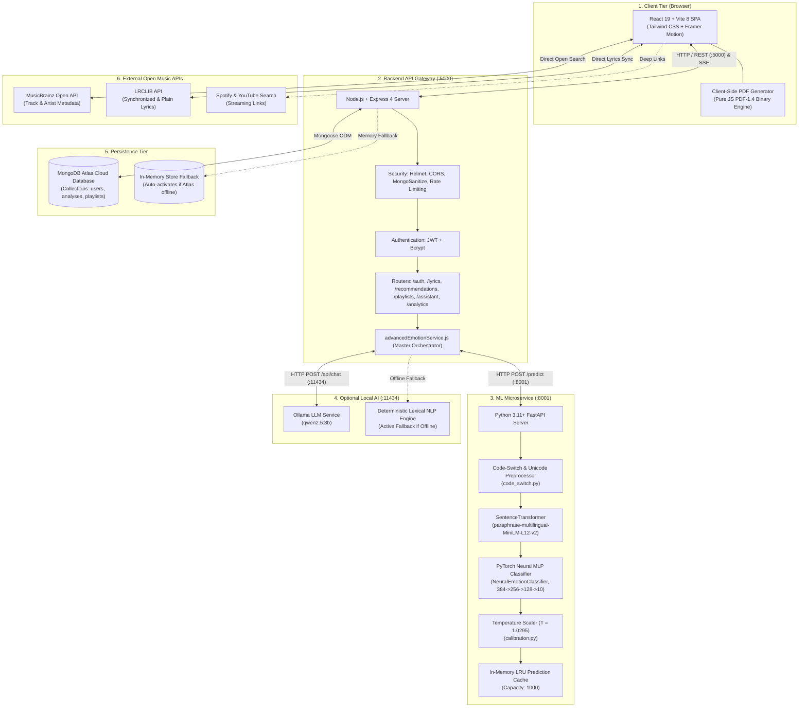
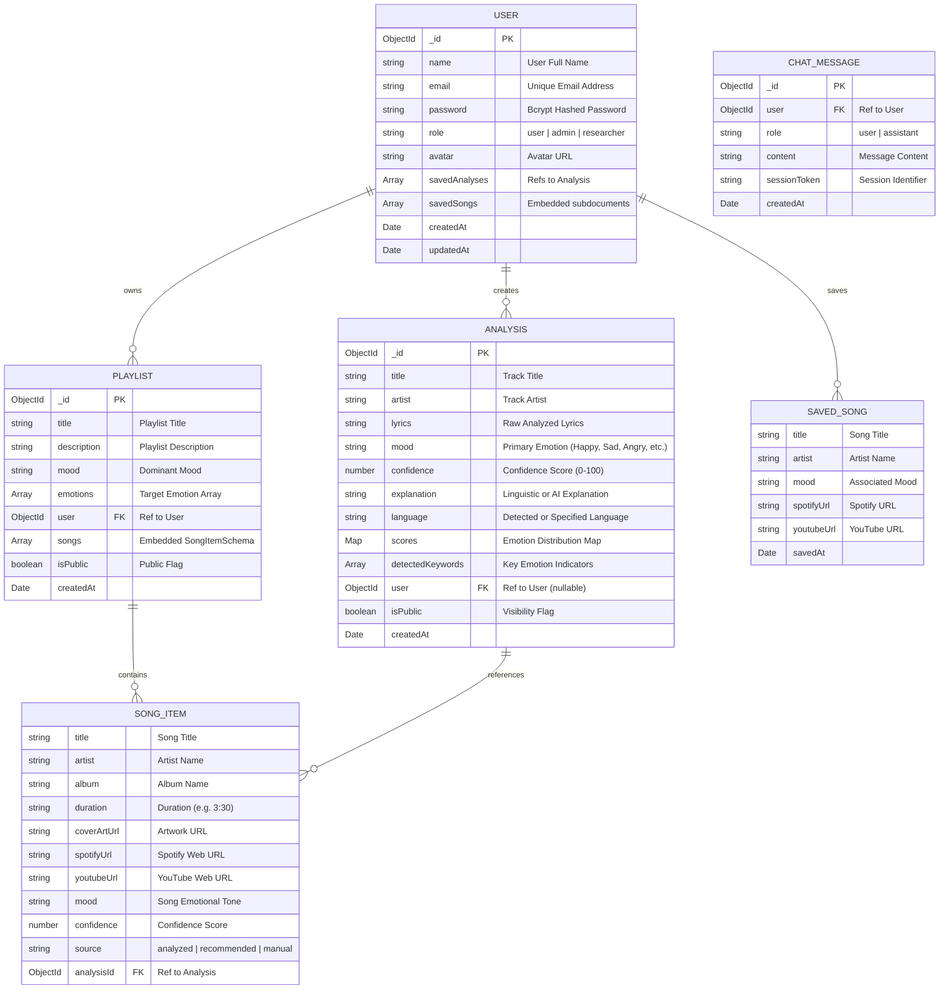
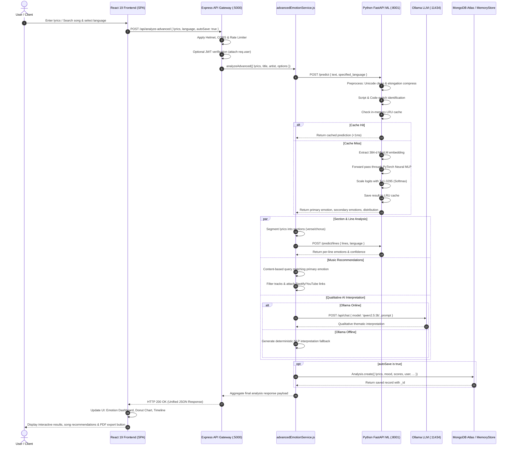

# 🎵 EmoLyrics — Complete Original System Architecture Documentation

> **System Source of Truth & Technical Architecture Reference**  
> **Repository:** [https://github.com/HarshitRaj31/Emolyrics](https://github.com/HarshitRaj31/Emolyrics)  
> **Status:** Strictly Preserved Original System Implementation  
> **Target:** Technical Evaluation, Academic Defense & Architectural Documentation  

---

## 📋 Executive Overview

**EmoLyrics** is an AI-powered multilingual music intelligence and lyrics emotion classification platform. The system classifies song lyrics across **10 fine-grained canonical emotion categories** in **5 primary languages** (English, Hindi, Bengali, Spanish, French) and transliterated code-switched scripts (Hinglish, Banglish).

The platform is architected around a distributed multi-tier topology:
1. **Frontend:** React 19 + Vite 8 Single Page Application (SPA).
2. **API Gateway / Backend:** Node.js 20+ + Express 4 server.
3. **Database:** MongoDB Atlas (with automatic in-memory fallback store).
4. **Machine Learning Service:** Python 3.11+ FastAPI microservice utilizing SentenceTransformers and PyTorch.
5. **AI Assistant:** Local Ollama LLM (`qwen2.5:3b`) with deterministic rule-based fallback.
6. **PDF Reporting:** Pure JavaScript client-side vector PDF-1.4 generator.

---

## 1. 🏛️ Original System Architecture Diagram

The high-level architecture diagram illustrates the separation of concerns across the client, backend gateway, ML microservice, database, and external open music services.



---

## 2. 💻 Frontend Architecture Diagram

The frontend is a modular Single Page Application built on React 19, Vite 8, and Tailwind CSS. It communicates with the backend via a centralized API service and handles state management using React Context.

```mermaid
flowchart TD
    subgraph FRONTEND_ENTRY ["Entry Point & Context Layer"]
        MAIN["main.jsx"]
        APP["App.jsx"]
        ROUTER["BrowserRouter (react-router-dom)"]
        AUTH_CTX["AuthContext\n(User, Login, Register, Logout)"]
        THEME_CTX["ThemeContext\n(Dark / Light Mode, CSS Variables)"]
        PERS_CTX["PersonalizationContext\n(History, Favorites, Recent Searches)"]
        PLUG_CTX["PluginContext\n(Integration Adapters)"]

        MAIN --> APP --> ROUTER
        ROUTER --> AUTH_CTX --> THEME_CTX --> PERS_CTX --> PLUG_CTX
    end

    subgraph PAGES ["Page Routing Layer"]
        ANALYZER["/ (AnalyzerPage.jsx)\n- Lyrics Studio Workbench\n- Dual Input & Song Search"]
        ASSISTANT["/assistant (AssistantPage.jsx)\n- AI Copilot Interface\n- Streaming SSE Chat"]
        EXPLORE["/explore (ExplorePage.jsx)\n- Community Feed & Mood Cards"]
        RECS["/recommendations (RecommendationsPage.jsx)\n- Mood-Based Song Discovery"]
        PLAYLISTS["/playlists (PlaylistsPage.jsx)\n- Smart Mood Playlist Studio"]
        ANALYTICS["/analytics (AnalyticsPage.jsx)\n- Lyrical Sentiment Trends"]
        PROFILE["/profile (ProfilePage.jsx)\n- User Library & Saved Tracks"]
        PLUGINS["/plugins (PluginMarketplacePage.jsx)\n- Extensibility Center"]

        PLUG_CTX --> PAGES
    end

    subgraph COMPONENTS ["Key Reusable Component Modules"]
        NAV["Navbar.jsx\n- NavLinks, Theme Toggle, Auth Status"]
        DISCOVERY["SongDiscovery.jsx\n- MusicBrainz & LRCLIB search\n- Zero-scraping sync"]
        DASHBOARD["EmotionDashboard.jsx\n- EmotionSummaryCards.jsx\n- EmotionDonutChart.jsx (SVG)\n- ConfidenceGauge.jsx"]
        ANALYSIS_COMP["AdvancedMoodAnalysis.jsx\n- Line-by-line sentiment timeline\n- Section breakdown\n- Emotion filter chips"]
        RECOMMEND_COMP["MoodRecommendations.jsx\n- Spotify & YouTube card links\n- Why Recommended explainer"]
        PDF_BUTTON["PdfDownloadButton.jsx\n- In-browser PDF generation"]
    end

    subgraph SERVICES ["Frontend Services & Utilities"]
        API_CLIENT["src/services/api.js\n(Fetch wrapper with JWT headers & SSE reader)"]
        PDF_ENGINE["src/components/dashboard/pdfReportGenerator.js\n(Pure JS PDF-1.4 vector generator)"]
        THEME_UTIL["src/utils/emotionTheme.js\n(Color tokens, gradients, badges)"]
    end

    ANALYZER --> DISCOVERY
    ANALYZER --> DASHBOARD
    ANALYZER --> ANALYSIS_COMP
    ANALYZER --> RECOMMEND_COMP
    ANALYZER --> PDF_BUTTON

    PAGES --> API_CLIENT
    PDF_BUTTON --> PDF_ENGINE
    DASHBOARD --> THEME_UTIL
```

---

## 3. ⚙️ Backend Architecture Diagram

The backend acts as an API Gateway and business logic coordinator built on Node.js and Express 4. It coordinates authentication, rate limiting, persistence, Python ML requests, and Ollama LLM integration.

```mermaid
flowchart TD
    subgraph SERVER_INIT ["Server Bootstrap & Middleware Stack"]
        SERVER["server.js (HTTP listener on PORT 5000)"]
        APP_FACTORY["app.js (createApp Factory)"]
        ENV_VAL["config/envValidator.js (Zero-Leak Env Auditor)"]
        HELMET["Security: Helmet (CSP, HSTS, XSS)"]
        CORS_MW["CORS Middleware (Dynamic Whitelist + Regex)"]
        SANITIZE["mongoSanitize Middleware (NoSQL Injection Defense)"]
        LIMITER["rateLimiter.js (Express Rate Limit)"]
        AUTH_MW["auth.middleware.js (JWT Verification: optionalJWT / authenticateJWT)"]

        SERVER --> APP_FACTORY --> ENV_VAL --> HELMET --> CORS_MW --> SANITIZE --> LIMITER --> AUTH_MW
    end

    subgraph ROUTE_CONTROLLERS ["Route Handlers (/api)"]
        R_AUTH["/api/auth (auth.routes.js)\n- /register, /login, /me"]
        R_ANALYSIS["/api (analysis.routes.js)\n- /analyze-mood\n- /analyze-multilingual\n- /analyze-lines\n- /analyze-advanced\n- /ml-health"]
        R_MUSIC["/api/music & /recommendations (music.routes.js)\n- /recommend, /search, /genres"]
        R_PLAYLIST["/api/playlists (playlist.routes.js)\n- CRUD, smart generator, export"]
        R_ASSISTANT["/api/assistant (assistant.routes.js)\n- /chat, /chat/stream (SSE)"]
        R_ANALYTICS["/api/analytics (analytics.routes.js)\n- /trends, /distribution, /stats"]
        R_USER["/api/users (user.routes.js)\n- /saved-songs, /saved-analyses"]

        AUTH_MW --> ROUTE_CONTROLLERS
    end

    subgraph CORE_SERVICES ["Backend Services Layer"]
        ADV_EMOTION["advancedEmotionService.js\n- Orchestrates Multi-Tier Emotion Analysis\n- Coordinates ML + Sectioning + Recommendations + Ollama"]
        ML_SERVICE["multilingualMLService.js\n- Connects to Python FastAPI on :8001\n- Enforces Non-English Fallback Policy\n- Short-TTL Health Check Cache"]
        REC_SERVICE["recommendationService.js\n- Content-Based Song Recommender\n- Genre, Valence & Arousal Weighting"]
        AI_ASSISTANT["aiAssistantService.js\n- Ollama HTTP Client (:11434)\n- Prompt Builder & Realtime SSE Streamer\n- Deterministic Rule-Based Fallback"]
        SECTION_SERVICE["songSectionService.js\n- Verse, Chorus, Bridge Pattern Detection"]
    end

    R_ANALYSIS --> ADV_EMOTION
    ADV_EMOTION --> ML_SERVICE
    ADV_EMOTION --> SECTION_SERVICE
    ADV_EMOTION --> REC_SERVICE
    ADV_EMOTION --> AI_ASSISTANT
    R_MUSIC --> REC_SERVICE
    R_ASSISTANT --> AI_ASSISTANT
```

---

## 4. 🗄️ Database Architecture Diagram

The persistence layer uses **MongoDB Atlas** managed through **Mongoose ODM**. If MongoDB is offline, an integrated in-memory fallback store (`memoryStore`) maintains functionality without crashes.



---

## 5. 🧠 Machine Learning Processing Architecture Diagram

The Python ML microservice provides multilingual emotion classification without automated machine translation. It extracts dense embeddings via a multilingual Sentence Transformer and classifies them using a trained PyTorch Multi-Layer Perceptron with temperature calibration.

```mermaid
flowchart TD
    subgraph INPUT_PREPROC ["Input Normalization & Script Audit"]
        RAW_TEXT["Raw Lyrics Text (Up to 5,000 characters)"]
        SANITIZATION["Zero-Width Space & NBSP Stripping\n(replace \u200b and \xa0)"]
        ELONGATION["Poetic Elongation Compression\nRegex: (.)\\1{2,} -> \\1\\1 (e.g. happpyyy -> happyy)"]
        SCRIPT_ANALYSIS["Script Identification & Code-Switch Audit\n- Devanagari (Hindi) [\u0900-\u097F]\n- Bengali [\u0980-\u09FF]\n- Latin Accented (Spanish / French)\n- Hinglish / Banglish Lexicon Matching"]

        RAW_TEXT --> SANITIZATION --> ELONGATION --> SCRIPT_ANALYSIS
    end

    subgraph FEATURE_EXTRACT ["Feature Extraction Layer (SentenceTransformers)"]
        MODEL_NAME["Base Model: paraphrase-multilingual-MiniLM-L12-v2"]
        TOKENIZER["Multilingual Subword Tokenizer (Max Length: 128)"]
        TRANSFORMER_ENCODER["12-Layer Multilingual Transformer Encoder\n(Frozen Weights, Local Snapshot Loaded)"]
        MEAN_POOLING["Mean Pooling over Token Representations"]
        L2_NORM["L2 Vector Normalization"]
        EMBEDDING["384-Dimensional Dense Semantic Vector\nx ∈ ℝ³⁸⁴"]

        SCRIPT_ANALYSIS --> TOKENIZER --> TRANSFORMER_ENCODER --> MEAN_POOLING --> L2_NORM --> EMBEDDING
    end

    subgraph NEURAL_CLASSIFIER ["Neural Classifier Layer (PyTorch NeuralEmotionClassifier)"]
        NORM_IN["Input LayerNorm(384)"]
        LAYER_1["Linear(384 -> 256) + LayerNorm(256) + ReLU + Dropout(0.3)"]
        LAYER_2["Linear(256 -> 128) + LayerNorm(128) + ReLU + Dropout(0.3)"]
        HEAD["Linear(128 -> 10) Output Head"]
        LOGITS["Raw Emotion Logits Vector\nz = [z₁, z₂, ..., z₁₀] ∈ ℝ¹⁰"]

        EMBEDDING --> NORM_IN --> LAYER_1 --> LAYER_2 --> HEAD --> LOGITS
    end

    subgraph CALIBRATION_OUTPUT ["Calibration & Emotion Taxonomy"]
        TEMP_SCALING["Temperature Calibration\np_i = exp(z_i / T) / Σ exp(z_j / T)\nCalibrated Temperature: T = 1.0295\nCalibrated ECE: 0.0538 (-12.38% error)"]
        UNCERTAINTY["Uncertainty & Confidence Assessment\n(Entropy, Margin, Threshold Auditing)"]
        CLASSES["10 Canonical Emotion Categories:\n1. Happiness  2. Sadness    3. Love        4. Anger      5. Nostalgia\n6. Fear       7. Excitement 8. Hope        9. Loneliness 10. Calmness"]
        CACHE_STORAGE["Thread-Safe LRU Prediction Cache\n(Key: lang::hash(text), Size: 1000, <1ms repeat response)"]

        LOGITS --> TEMP_SCALING --> UNCERTAINTY --> CLASSES --> CACHE_STORAGE
    end
```



---

## 6. 🔄 Complete End-to-End Data Flow Diagram

This diagram traces the entire life cycle of an analysis request from user input in the browser to persistence and final presentation.



---

## 7. 🛡️ Verification & Preservation Audit

| Category | Policy Checked | Current Verified Status |
|---|---|---|
| **Frontend Source Files** | Zero internal refactoring, redesign, or component changes | **Unmodified** (Matches original `origin/main` commit) |
| **Backend Source Files** | Zero endpoint, controller, or middleware modifications | **Unmodified** (Matches original `origin/main` commit) |
| **Database Schema** | Zero schema, collection, or database modifications | **Unmodified** (Mongoose schemas preserved) |
| **ML Models & Weights** | Zero model substitution, no re-training, no architecture changes | **Unmodified** (`multilingual_classifier.pt` preserved) |
| **Dependencies** | No packages added, upgraded, or removed | **Unmodified** (`package.json` files intact) |
| **API Contracts** | No changes to request/response schemas or URLs | **Unmodified** (`/api/analyze-advanced`, etc. intact) |
| **Documentation Isolation** | Documentation kept separate from application source code | **Compliant** (Stored exclusively in `docs/` and reports) |

---

*Authored by the EmoLyrics Research & Engineering Team (Larana, Inc.)*  
*Contributors: Chandrima Chawdhury (Lead), Harshit Raj (ML & Features), Sristi Priya (Frontend), Dibyendu Khamaru (Datasets), Tribeni Ghorai (Architecture & Integration)*
